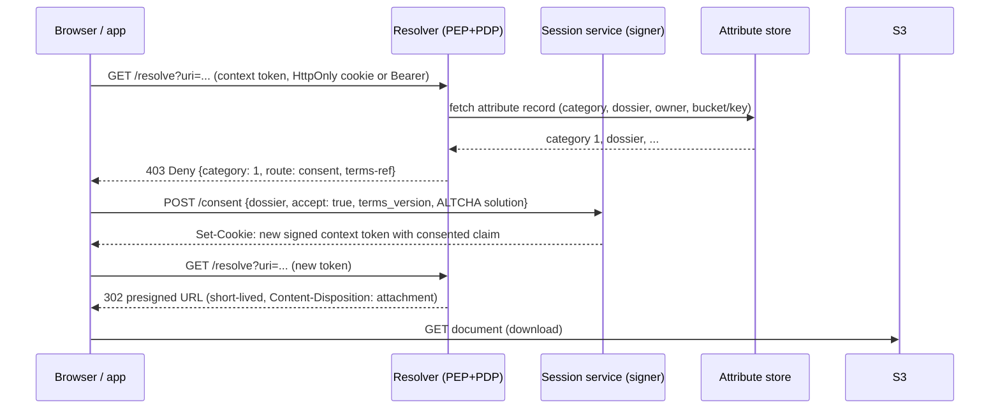
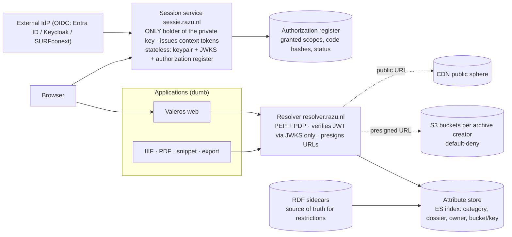

# Access restrictions in the RAZU e-depot — architecture overview

Status: design, for discussion · Last update: 2026-11-20

This is an English summary. The authoritative documents are in Dutch:
`requirements-toegangsbeperkingen.md` (the *what* and *why*) and
`architectuur-toegangsbeperkingen.md` (the full architectural elaboration).

## 1. The problem

Not every document in the e-depot is public. Restrictions (privacy / GDPR, copyright,
statutory openness) each have an **end date**. Every document gets one of four access
categories:

| Cat | Meaning | Required context |
| --- | --- | --- |
| 0 | public | none |
| 1 | personal copy after accepting the terms | `consented` (per dossier) |
| 2 | study room only | `studyroom` |
| 3 | individually granted access | `granted` (scope-specific) |

Contexts **stack**: the more context matches, the more access. A `granted` scope also
covers cat-1/cat-2 documents inside it — no separate consent or study-room visit needed.

## 2. Core idea: one chokepoint

All non-public documents leaves the depot through exactly **one route**: the **resolver** —
`GET /resolve?uri={persistent URI}` plus a signed **context token**. It answers with:

- a redirect to the public CDN URI (cat 0), or
- a redirect to a short-lived **presigned S3 URL** (cat 1–3, permit), or
- **deny** + the basic category + the route to access anyway (consent / study room / request).

The web app (Valeros), IIIF, PDF generation, snippets and export are deliberately "dumb":
they only ever ask the resolver, and enforce nothing themselves. The persistent URI stays
the access key for every document.

## 3. Components and trust model

Key properties:

- **The resolver never trusts the calling app.** It only accepts tokens signed by the
  session service (JWS/JWT, ES256, keys distributed via JWKS). An unverifiable or expired
  token is treated as an empty context → deny for cat 1–3.
- **Two hosts, split by key ownership**: `sessie.razu.nl` signs (private key),
  `resolver.razu.nl` verifies (public key only). 
- **Transport**: browser = `HttpOnly` cookie (`Secure`, `SameSite=Lax`, `Domain=razu.nl`);
  machine clients (IIIF, export) = `Authorization: Bearer`. The token is never in a URL.
  On page load the browser calls `GET /sessie/context` (`credentials: "include"`); the
  service sets a cookie only when needed and returns the context claims as JSON.
- **Consent (cat 1)** lives only in the short-lived context token — there is no consent
  register (re-consent after token expiry, ~1h, is accepted by design). The browser POSTs
  `{dossier, accept: true, terms_version, ALTCHA solution}` directly to `/consent`; the
  terms *text* is never posted, only the version ID, checked against the centrally managed
  current version.
- **`granted` (cat 3)** via organization SSO (OIDC: Entra ID / Keycloak / SURFconext, with a
  `claim → scope` mapping) or a one-time exchange code. The **refresh credential** is a
  signed JWT cookie, host-only on `sessie.razu.nl` (never travels to the resolver); at
  `/sessie/refresh` the service re-reads the authorization register, so revocation takes
  effect within the token lifetime.
- **Study room (cat 2)**: edge-stamped IP (`X-Forwarded-For`, overwritten by the trusted
  edge — never a client-supplied header) or a terminal-bound token. Never a bare claim.

## 4. Blocking bot access to the cat-1 route

Layered, because a single measure is not enough against bots:

1. **ALTCHA** proof-of-work (widget on the Valeros page; challenge *and* verification at
   `sessie.razu.nl` — a bare POST without a valid solution gets 403)
2. **Honeypot field** in the consent form (hidden via CSS) — filled → no consent, logged,
   IP blocklisted
3. **Rate limiting** per IP (edge-stamped) and per session on `/consent` and `/resolve`
4. **IP blocking** on honeypot hit or repeated threshold breach
5. **Anomaly detection** on the audit log, with adaptive heavier PoW per IP

Forged tokens are not a route: every request verifies the signature.

## 5. Time and change

- Restrictions have end dates. A periodic (at least yearly) **reclassification** process
  updates the sidecars, the attribute store, the search index and the publication status
  (cat 0 → explicitly published; stricter → explicitly unpublished). A periodic
  **verification** compares actual public readability of every object against its
  registered category and alerts on any mismatch.
- Policy changes are effective within a daypart: sidecars are the source of truth, the
  store is updated explicitly, decisions are not (or only very briefly) cached, unknown
  URIs are denied.

## 6. Strengths of the design

- **One enforcement point, one audit log** — every access to cat 1–3 passes the resolver:
  who accessed which document at which context level. Policy changes happen in exactly one
  place.
- **Stateless, minimal trust core** — the resolver only verifies signatures; the session
  service is stateless (keypair + JWKS); no session or consent registers; every fact has
  exactly one owner (RDF sidecars for restrictions, authorization register for grants).
- **No new infrastructure** — FastAPI, Elasticsearch, S3/boto3, JWT/OIDC, ALTCHA, all in the
  existing stack; the existing SURA URI-resolver can serve as the resolver's base.
- **Boring, established standards only** — JWS/JWT + JWKS, OpenID Connect, SigV4 presigned
  URLs, CORS, RFC 6265 cookie semantics, IIIF Authentication API 2.0 patterns; the XACML
  role split (PEP/PDP/PIP/PAP) without the XACML protocol. Maps 1:1 onto a Microsoft
  landscape (Entra ID as IdP, Azure SAS instead of SigV4).
- **Abuse-resistant low-threshold personal access** — the layered anti-automation above; the cat-1
  flow is aimed at *downloading* a personal copy (`Content-Disposition: attachment`),
  not at online viewing.
- **Automatic expiry, fast reclassification** — time-bound restrictions are enforced by
  process plus verification, not by runtime checks alone.

## 7. Accepted residual risks (with compensations)

| Risk | Compensation |
| --- | --- |
| Context token forged or shared | short lifetime, asymmetric signing, scope limits; study-room context bound to network/terminal |
| Stale attributes after reclassification | explicit store update; store↔sidecar verification; decisions not/briefly cached |
| Harvesting via the cat-1 route | layered anti-automation (§4); consent per dossier |
| Resolver as single point of failure | highly available, deliberately simple component; the public cat-0 route keeps working via CDN |
| The audit log is itself GDPR-sensitive | retention policy, access limited to security/reporting, covered by the privacy scheme |

## 8. Open points

- Need for / appoach to restricting access to metadata, other than not indexing the field or storing it in a not publicly available datatest (like the use of an Elasticsearch proxy for metadata)
- Shape of the employee token (per archive creator / per document type / free selection)
- Decentralized user-management coupling for participating municipalities
- Printing / personal copies in the study room; verification step for the e-mail route
- Reporting functionality (the data is already in the resolver audit log)
