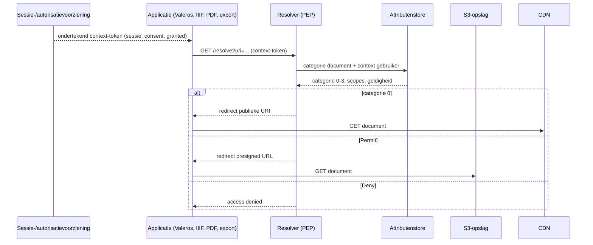

# Architectuur: afdwingen van toegangsbeperkingen RAZU e-depot

Status: ontwerp, ter bespreking
Laatste update: 2026-11-17
Requirements: `requirements-toegangsbeperkingen.md` — dit document bevat uitsluitend de architecturale uitwerking; het **wat** en **waarom** (categorieën, actoren, matrix, metadata-beleid, beheer-eisen) staat dáár. Waar het requirements-document nog open vragen bevat, is dat in de tekst gemarkeerd met **[TBV]** (ter bespreking).

## 1. Doel en uitgangspunten

De toegangsvoorziening moet de geldende beperkingen afdwingen over alle routes waarlangs content het e-depot verlaat: web (Valeros), IIIF-tiles, PDF-generatie, snippets en exports. Het ontwerp kent drie randvoorwaarden:

1. **Aansluiting op de bestaande gelaagde architectuur** — hergebruik van bestaande componenten (S3-replica, CDN, SURA, RDF-sidecars als bron van waarheid); geen vervanging van lagen.
2. **Eenvoud boven complexiteit** — één beslisregel, één uitgiftepunt, geen aparte autorisatie-infrastructuur die de vier categorieën niet nodig hebben.
3. **Bewust geaccepteerd rest risico** — maximale toegankelijkheid impliceert dat onbedoelde beschikbaarstelling als geaccepteerd risico wordt gedocumenteerd (zie §7).

## 2. Model

### 2.1 Documenttoegang

De vier documentcategorieën (0–3) en de actor-matrix staan in requirements §1.2.2. Voor de handhaving volstaat de vertaling naar een vereist **context-niveau**:

| Basiscategorie | Vereiste context |
| --- | --- |
| 0 | geen |
| 1 | `consented` (instemming voorwaarden, per dossier) |
| 2 | `studyroom` |
| 3 | `granted` (individueel verleende, scope-specifieke toegang) |

Twee regels voltooien het beslisbeleid:

- **Stapeling**: wie op meerdere gronden toegang heeft (bijv. `studyroom` én een `granted` scope), krijgt de ruimste combinatie. Het context-niveau is dus geen enum maar een verzameling. Een `granted` bezoeker krijgt toegang tot alles wat voor hem is verleend, uiteraard categorie 0, categorie 1 na instemming, en categorie 2 wanneer hij zich in de studiezaal bevindt: hoe meer context matcht, hoe meer toegang. (De actor-matrix in requirements §1.2.2 beschrijft daarmee het typische gebruik per actor, geen verbod op combinaties.)
- **Scope-specificiteit**: een `granted`-toegang geldt uitsluitend voor de documenten of dossiers waarvoor hij is verleend. Valt binnen zo'n scope een document met basiscategorie 1 of 2, dan telt voor die actor de via categorie 3 verkregen toegang — niet de basiscategorie.

### 2.2 Metadata en vindbaarheid

De beperkingsregels op metadata en vindbaarheid (incl. dossierniveau) staan in requirements §1.2.3. Architectonisch vertaalt zich dit naar **structurele afdwinging**: wat niet in de zoekindex en de publicatie-metadata staat, is onvindbaar en ontoonbaar. Er is dus geen runtime-filter op zoekresultaten nodig; de filtering vindt plaats bij het vullen van index en presentatievlagen.

**[TBV]** Er staat in de requirements nog de optie om in plaats daarvan een Elasticsearch-proxy in te zetten die per query filtert. Dat is complexer en foutgevoeliger dan filtering bij indexering; dit ontwerp kiest daarom voor structurele filtering, tenzij eisen over zoekbaarheid van afgeschermd materiaal (bijv. "mag er wél op gezocht worden?") anders dicteren. Voor tekstknipsels bij kranten geldt: de snippet-service respecteert dezelfde metadata-regels als de presentatielaag; omdat de bestaande auteursrechtelijke bezwaren zien op beeldmateriaal (dat zich niet als tekstknipsel laat representeren), kan de knipsel-beperking worden beperkt tot de daadwerkelijk beperkte subcollectie.

### 2.3 Rolverdeling: beslissen en handhaven

De architectuur volgt de rolverdeling uit de XACML-referentiearchitectuur (die NIST hanteert in SP 800-162), in een bewust vereenvoudigde vorm: geen aparte autorisatie-dienst, maar de rollen verdeeld over bestaande componenten.

- **PEP (Policy Enforcement Point)** — de **resolver**: de voorziening die als enige documenten uitgeeft. Elke toegangsvraag wordt hier gehandhaafd.
- **Beslislogica (PDP-functie)** — ingebouwd in de resolver, als gedeelde bibliotheek of module. Het beleid is klein (de tabel uit §2.1 plus stapeling en scope) en verdient geen eigen dienst; de logica moet wel op precies één plek geïmplementeerd zijn.
- **Contextbron: sessie-/autorisatievoorziening** — het component dat sessies en instemmingen administreert en het **context-token opstelt en ondertekent** (asymmetrisch: de resolver controleert met alleen een publieke sleutel en kan zelf geen tokens maken). Zij ondertekent nooit aangedragen claims, maar uitsluitend wat zijzelf in haar eigen administratie heeft vastgelegd (§3.2, Bijlage A). Dit is bewust een dun component: een sessieregister, een instemmingsregister, een koppeling naar het autorisatieregister en één sleutelpaar.
- **Autorisatieregister** — de administratie van verleende `granted`-toegangen (tijdelijk dan wel functiegebonden; zie A.5). Gevuld door beheerprocessen (archivaris, deelnemende organisaties), gelezen door de sessie-/autorisatievoorziening, door niemand anders gemuteerd. De administratie zelf is buiten scope (requirements §1.2.4); architectonisch is het een register met records: gebruiker → scope + geldigheid + verleend door.
- **Attribuutbronnen (PIP-rol)** — de bron van waarheid voor de categorie en einddatum per document blijft de RDF-sidecar, maar op de request-path bevraagt de resolver deze niet direct via SPARQL. In plaats daarvan wordt per document een attributenrecord **gematerialiseerd in een snelle attributenstore**: een eenvoudige database of een per-document entry in de bestaande Elasticsearch-index. De store wordt gevoed door het inname- en herclassificatieproces (§4). Een attributenrecord bevat minimaal:
  - de persistente **URI** van het document (sleutel),
  - de **basiscategorie** van het document. De **einddatum** van de beperking is voor het besluit zelf niet nodig (de resolver beslist uitsluitend op de actuele categorie), maar wordt wel in het record mee-genoteerd: het periodieke herclassificatieproces (§4) kan daarmee eenvoudig geautomatiseerd jaarlijks bepalen welke categorieën moeten worden bijgewerkt, zonder alle sidecars opnieuw te hoeven doorrekenen,
  - de **dossier-URI** waar het document toe behoort (voor de scope-checks bij `consented` en `granted`),
  - de **archiefvormer / eigenaar** van het document (en eventueel het **documenttype**). Hiermee kunnen `granted`-scopes als selectieregel worden geformuleerd ("alle documenten van archiefvormer Bunnik", of "alle bouwtekeningen van gemeente X") zonder dat het register een expliciete lijst URI's hoeft te bevatten; de resolver matcht de scope tegen deze attributen. (De opslag is per archiefvormer ingericht, dus dit attribuut volgt logisch uit de inname.)
  - een verwijzing naar de geldende **voorwaarden-tekst** voor de persoonlijke kopie. De teksten zelf staan **centraal** in een klein, beheerd aantal voorwaarden-documenten (bijv. per collectie of landelijk vastgesteld); in het attributenrecord staat uitsluitend een verwijzing (voorwaarden-ID of URI), zodat teksten op één plaats kunnen worden herzien zonder miljoenen records aan te passen. Per document kan slechts de *verwijzing* verschillen; dat het aantal teksten klein blijft is een beheerprincipe, geen architecturaregel,
  - de **opslaglocatie**: bucket en object-key (de buckets zijn per archiefvormer ingericht, dus niet uit de URI afleidbaar; de resolver heeft deze nodig voor het genereren van presigned URL's). De **publieke (CDN-)URI** voor categorie 0 kan volgens een vast, generiek patroon uit de persistente URI worden afgeleid en hoeft dan niet per document te worden opgeslagen; alleen bij afwijkende publicatielocaties (bijv. een aparte publicatieprefix of -bucket) wordt ook die opgeslagen.

  Het context-niveau van de gebruiker komt uit de authenticatie-/sessievoorziening (§3.2).
- **Handhaving na uitgifte** — presigned URL's op S3 dwingen af dat verleende toegang tot categorie 1–3 begrensd blijft in tijd en bereik. Voor het CDN worden **geen** JWT-tokens gebruikt: kale opslag-URI's van categorie-0-documenten moeten zonder tussenkomst van een token blijven werken.

De website (Valeros) en de ondersteunende services (IIIF, PDF, snippet, export) zijn 'dom': zij vragen elk document uitsluitend via de resolver aan en handhaven zelf niets.

Eén nuance bij de eis "één bron van waarheid" (requirements §1.2.4): het ontwerp kent drie registers, maar elk registreert een eigen soort feit met een eigen eigenaar — de **RDF-sidecars** voor de toegangsbeperkingen per document (bron van waarheid in de zin van de eis), het **instemmingsregister** (deel van de sessievoorziening) voor de actuele instemmingen per sessie, en het **autorisatieregister** voor verleende rechten per gebruiker. Er is geen overlap tussen de drie: geen enkel feit wordt in meer dan één register beheerd. Daarmee blijft de eis overeind in zijn kern: nergens hoeven administraties "in de pas te lopen", want elk feit heeft precies één plek.

## 3. Uitgifte via de resolver

### 3.1 Het vaste patroon

Alle applicaties en services verkrijgen documenten uitsluitend via één patroon:

> Een GET-verzoek aan de resolver met de **persistente URI** van het document, vergezeld van een authentiek **context-token** van de gebruiker. De resolver antwoordt met een redirect naar de publieke URI (categorie 0), een redirect naar een **presigned URL** (toegang verleend voor categorie 1–3), of een **access denied**.



Consequenties:

- De **persistente URI blijft de access-key**: ook afgeschermde documenten worden via hun datalaag-URI aangesproken (requirements §1.2.1), alleen langs de resolver, die de vereiste authenticatie-/autorisatiestap afdwingt.
- **Alle uitgiftekanalen lopen langs hetzelfde chokepoint**: webweergave, IIIF-tiles, PDF-generatie, snippets en export gebruiken identiek dezelfde route. Er is geen route die "hoopt" dat een object public read is.
- **Eén auditlog**: elk verzoek aan elk document van elke applicatie passeert de resolver en wordt gelogd (wie, welk document, welk context-niveau, welk besluit, wanneer).
- **Eén plek voor beleidswijziging**: een nieuw context-niveau of een aangepaste matrix betekent alleen een aanpassing van de resolver.

De resolver kan worden opgebouwd uit of aansluiten op de bestaande voorziening **SURA**, die al URI's naar URL's kan vertalen. De JWT-mogelijkheid van SURA voor het CDN blijft in dit ontwerp **ongebruikt**: kale opslag-URI's van publieke documenten moeten zonder token blijven werken, en handhaving na uitgifte is voor categorie 1–3 geregeld met presigned URL's op S3. Dit ontwerp maakt SURA tot het natuurlijke fundament van de resolver: URI → besluit → URL.

### 3.2 Context-niveaus: hoe de resolver weet wie er vraagt

De resolver vertrouwt **nooit** een context-niveau dat de aanroepende applicatie zelf verzint; anders is de PEP via een leugen te omzeilen. Het context-niveau wordt aangeleverd als een door de authenticatievoorziening ondertekend token:

- **`consented`** — de gebruiker (online bezoeker of studiezaalbezoeker) heeft de voorwaarden voor de persoonlijke kopie geaccepteerd; de instemming geldt per dossier en wordt als zodanig in het token gecodeerd (of bijgehouden in een sessievoorziening die de resolver raadpleegt).
- **`studyroom`** — de aanvraag komt uit de studiezaal-voorziening (terminal of studiezaalnetwerk), technisch herkenbaar aan een terminalspecifiek token of netwerkherkomst. Er is geen individuele aanmelding; de terminal zelf treedt op als aangewezen "gebruiker".
- **`granted`** — de individueel aangemelde gebruiker (geautoriseerde bezoeker of medewerker van een deelnemende organisatie) met de verleende scopes. De scopes staan in het token, ontleend aan het autorisatieregister (§2.3). Omvangrijke verleningen worden als **selectieregel** geformuleerd (op archiefvormer/documenttype) in plaats van als expliciete URI-lijst, zodat het token compact blijft.

De vertaling van actoren (requirements §1.2.2) naar context-niveaus: de online bezoeker kan uitsluitend `consented` verwerven; de studiezaalbezoeker `consented` en `studyroom`; de geautoriseerde bezoeker en de medewerker `granted`; de geautomatiseerde gebruiker geen van alle — hij krijgt alleen categorie 0, binnen de bestaande CDN-begrenzingen. **[TBV]** De decentrale gebruikersbeheer-eis (beheer via systemen van deelnemende gemeenten, requirements §1.2.4) impliceert een koppeling tussen die systemen en de token-/autorisatievoorziening; de vorm van het medewerkers-token (per archiefvormer, per documenttype, of vrije selectie) is nog te specificeren.

### 3.3 Afhandeling van een weigering

Een access denied is niet het einde van de interactie, maar het begin van een route naar wél toegang (randvoorwaarde: maximaal laagdrempelig, binnen de grenzen):

- Categorie 1 → aanbod om de voorwaarden te accepteren (instemming, daarna opnieuw aanvragen; dezelfde flow in de studiezaal).
- Categorie 2 → melding dat het document in de studiezaal te raadplegen is, met locatie-informatie.
- Categorie 3 → verwijzing naar de aanvraagroute bij de archivaris.
- Overal: waar een publiek toegankelijke afgeleide (toegangskopie) bestaat, verwijst de presentatielaag daarnaartoe (requirements §1.2.2, categorie 0).

Deze afhandeling gebeurt in de applicatielaag; de resolver geeft in zijn antwoord aan *waarom* toegang werd geweigerd (basiscategorie), zodat de applicatie de juiste route kan tonen.

## 4. Tijdelijkheid en verloop

Beperkingen hebben einddata (requirements §1): AVG-beperkingen 82 jaar na creatie, auteursrecht 140 jaar, archiefwettelijke beperkingen volgens vaststelling door de archiefvormer. Architectonisch betekent dit:

- De categorie is **berekend en vastgelegd** in de RDF-sidecars (per document), inclusief de einddatum van de beperking.
- Een periodiek (minimaal jaarlijks) proces herclassificeert documenten waarvan de beperking is verlopen (bijv. categorie 2 → 0) en werkt de sidecars, de zoekindex en — bij categorie 0 — de publicatiestatus (§5.2) bij. Daarmee is voldaan aan de eis dat verloop automatisch moet kunnen gebeuren (requirements §1.2.4).
- Bij herclassificatie naar categorie 0 wordt het object **expliciet gepubliceerd** (§5.2); bij herclassificatie naar een strengere categorie (verzaling, herijking) wordt de publieke status expliciet **ingetrokken**. Het metadata-attribuut alleen is niet voldoende; de publieke status in de opslag moet mee bewegen.

De eis "aanpassingen binnen een dagdeel effectief" (requirements §1.2.4) wordt gehaald doordat (a) de bron van waarheid de sidecars zijn, (b) herclassificatie een kwestie is van sidecar-, store- en index-update, en (c) de resolver per verzoek beslist tegen de attributenstore (§2.3). De attributenstore wordt bij herclassificatie expliciet bijgewerkt, zodat de "dagdeel"-garantie afhangt van het updateproces en niet van cache-verloop. Beslissingen zelf worden niet of hooguit zeer kort (minuten) gecached, zodat een beleidswijziging direct effect heeft. Onbekende URI's (niet in de store) worden eenduidig geweigerd: Deny.

## 5. Opslag en de publieke sfeer

### 5.1 Inrichting

De opslag kent **buckets per archiefvormer**, ongeacht de toegankelijkheid van de objecten daarin. Binnen elke bucket bevinden zich publiek leesbare objecten (categorie 0) en afgeschermde objecten (categorie 1–3) naast elkaar. Daarom geldt:

- Bucketpolicy's zijn **default-deny**: geen publieke toegang op bucketniveau, alleen via expliciete per-object of per-prefix regelingen voor de publieke sfeer.
- Objecten met categorie 1–3 zijn uitsluitend benaderbaar via presigned URL's die de resolver uitgeeft; er is geen andere leesroute voor applicaties.

### 5.2 De publieke sfeer en de kern-garantie

Voor categorie 0 is geen runtime-handhaving nodig: "publiek leesbaar" ís het beleid. De architectuur garandeert daarom niet dat álle toegang via de resolver loopt, maar de zwakkere maar toetsbare stelling:

> **Uitsluitend documenten met categorie 0 zijn publiek leesbaar.**

Deze garantie wordt niet in de request-flow afgedwongen maar in het classificatieproces en de opslagconfiguratie:

1. Bij inname en bij herclassificatie wordt de publieke status van het object in overeenstemming gebracht met de categorie in de sidecar (publiceren bij 0, intrekken bij ≥ 1).
2. Een **periodieke verificatie** vergelijkt, over alle buckets, de feitelijke publieke leesbaarheid van elk object met de geregistreerde categorie, en alarmeert bij elke mismatch (publiek maar niet categorie 0, óf afgeschermd maar onterecht publiek). Deze controle is het belangrijkste compenserende mechanisme voor het rest risico in §7.
3. De publieke leesbaarheid van categorie 0 wordt bij voorkeur geconcentreerd (prefix per bucket of een publicatielocatie per archiefvormer), zodat controle en intrekking overzichtelijk blijven. **[TBV]** — de keuze tussen per-object ACL's en een geconcentreerde publieke prefix is nog open; het ontwerp werkt met beide, maar een geconcentreerde prefix maakt de periodieke verificatie eenvoudiger.

Directe publieke toegang (zonder resolver) verloopt via het bestaande CDN, dat tevens de begrenzing van harvesting afdwingt (requirements §1.2.2, categorie 0).

## 6. Metadata-voorzieningen

- **Zoekindex (Elasticsearch)** en **triple store** worden gevuld vanuit de RDF-sidecars, mét de metadata-beperkingen toegepast: niet-toegestane velden worden niet geïndexeerd, niet-toonbare dossiers worden niet opgenomen. Afdwinging is structureel (§2.2), niet per query.
- De **snippet-service** raadpleegt de tekst met dezelfde categorie-afweging: bij categorie 1–3 zonder passend context-niveau wordt geen knipsel uitgegeven, ook niet als de tekst in de index staat. **[TBV]** — of beperkt materiaal überhaupt geïndexeerd moet worden (en dus vindbaar op termen, zij het zonder tonen), is een requirements-vraag; dit ontwerp kiest de veiligste interpretatie: niet vinden wat niet getoond mag worden.
- De relatie tussen een beperkt origineel en zijn publieke toegangskopie (afgeleide) wordt in de metadata vastgelegd (requirements §1.2.2), zodat de presentatielaag bij een weigering kan doorverwijzen en zoekresultaten direct de publieke afgeleide kunnen tonen.

## 7. Rest risico's en compenserende maatregelen

Het ontwerp accepteert bewust risico ten gunste van maximale toegankelijkheid (requirements §1). De belangrijkste rest risico's:

| Risico | Oorzaak | Compensatie |
| --- | --- | --- |
| Verkeerde classificatie bij inname (moet ≥ 1, staat als 0) | classificatie is geen exacte wetenschap; op de openbare route is geen runtime-check | periodieke verificatie (§5.2); expliciete toegangskopie-route; herijking na bezwaar |
| Tijdelijke blootstelling na verzaling/herijking | publieke objecten blijven leesbaar tot intrekking | herclassificatieproces trekt publicatie expliciet in; verificatie detecteert achterblijvers |
| Context-token vervalst of gedeeld | tokens zijn de zwakste schakel in §3.2 | korte geldigheid, ondertekening door de authenticatievoorziening, beperkte scope; studiezaal-context gebonden aan terminal/netwerk |
| Verouderde attributen na herclassificatie | attributenstore loopt achter op de sidecars | store-expliciet bijwerken bij herclassificatie (§4); periodieke verificatie vergelijkt store met sidecars; besluiten niet of zeer kort cachen |
| Misbruik categorie-1-route voor harvesting | de instemmingsroute is laagdrempelig; een harvester kan de legale route (sessie starten, instemmen, ophalen) automatiseren | instemming per dossier; rate limiting op de resolver (plafond op resolves én nieuwe instemmingen per sessie/IP); anomaliedetectie op het auditlog (patroon: veel sessies met telkens één dossier); eventueel conditioneel een drempelverhogende stap (CAPTCHA/e-mail) bij vermoeden van automatisering. Vervalste tokens zijn géén route: de ondertekening door de sessievoorziening wordt per aanroep geverifieerd (§3.2) |
| Resolver als single point of failure | alle uitgifte van categorie 1–3 via één voorziening | hoge beschikbaarheid van een bewust eenvoudige component; publieke route (categorie 0) blijft via CDN ook bij resolver-uitval werken |
| De auditlog als gegevensverzameling | het log registreert wie welke categorie 1–3-documenten raadpleegt; daarmee is het zelf AVG-gevoelig (§A.1) | bewaartermijn vaststellen, toegang beperken tot beveiliging/rapportage, log meenemen in de privacy-regeling |

## 8. Open punten (TBV)

1. ES-proxy versus structurele filtering (§2.2) — afhankelijk van de vraag of beperkt materiaal vindbaar moet zijn.
2. Publieke sfeer per-object ACL versus geconcentreerde prefix (§5.2).
3. Vorm van het medewerkers-token voor deelnemende organisaties: per archiefvormer, per documenttype, of vrije selecties (requirements §1.2.2, NB). De architectuur ondersteunt selectieregels op basis van de archiefvormer- en type-attributen (§2.3, A.5); welke selecties in de praktijk worden verleend, is een beheerkeuze.
4. Decentrale koppeling voor gebruikersbeheer van deelnemende gemeenten (requirements §1.2.4).
5. Persoonlijke kopieën in de studiezaal (printen) en handmatige verificatie bij de e-mail-route (requirements §1.2.2, categorie 1).
6. Rapportage-functionaliteit (requirements §1.2.4) — de resolver-auditlog levert hiervoor de gegevens.
7. ~~Stapeling versus actor-matrix~~ — **beslist (2026-11-17)**: de stapelingsregel is de norm. Een `granted` bezoeker krijgt toegang tot alles wat voor hem is verleend, uiteraard categorie 0, categorie 1 na instemming, en categorie 2 wanneer hij zich in de studiezaal bevindt. Hoe meer context matcht, hoe meer toegang. De actor-matrix in requirements §1.2.2 beschrijft het typische gebruik per actor (welke voorzieningen nodig zijn om tot een categorie te geraken), niet een verbod op combinaties. De resolver implementeert de stapelende variant (§2.1, A.6).

## Bijlage A: de resolver-flow per categorie

Deze bijlage beschrijft het request/response-patroon van de resolver en de vier flows in detail. Alle applicaties (Valeros, IIIF, PDF-generatie, snippet-service, export) gebruiken identiek dit patroon; er bestaat geen categorie-afhankelijke variant in de aanroep.

### A.1 Het vaste patroon

Elke toegangsvraag is:

```
GET /resolve?uri={persistente document-URI}
Authorization: Bearer {context-token}
```

- De **persistente URI** is de datalaag-URI van het document (requirements §1.2.1); ze fungeert als access-key.
- Het **context-token** reist in de header, niet in de URL (URL's lekken naar logs en browsergeschiedenis; de redirect-URI blijft kaal). Het wordt altijd meegestuurd, ook wanneer voor het document geen context nodig is: één patroon zonder uitzonderingen, en de applicatie weet vóór de aanroep immers niet welke categorie het document heeft. Voor een anonieme bezoeker bevat het token een lege context.
- De resolver negeert context-informatie die niet door de authenticatie-/sessievoorziening is ondertekend; hij vertrouwt dus nooit claims van de aanroepende applicatie zelf.

De mogelijke antwoorden:

| Situatie | Antwoord | Vervolg |
| --- | --- | --- |
| Permit, categorie 0 | redirect naar de publieke (CDN-)URI | document ophalen via CDN, resolver niet meer betrokken |
| Permit, categorie 1–3 | redirect naar presigned URL (kort geldig) | document ophalen via S3 |
| Deny | weigering + `basiscategorie` + `route` | applicatie toont de passende route (§A.3–A.6) |

Elke aanroep wordt gelogd: tijdstip, URI, context-samenvatting, besluit, afgeleverde URL-variant (publiek/presigned). Dit log vormt de basis voor de rapportage-functionaliteit (requirements §1.2.4). **Let op**: het log is zelf een AVG-gevoelige gegevensverzameling — bij categorie 1–3 staat er per definitie vast wie welke mogelijk persoonsgegevens bevattende documenten heeft geraadpleegd. Bewaartermijn, toegangsbeperking en verwerkingsdoel van het log moeten daarom vastgesteld worden (alleen raadplegen voor beveiliging en rapportage), en het log valt daarmee zelf onder de beveiligings- en privacyregeling van het e-depot.

Performance-aandachtspunt: één pagina-weergave via IIIF kan tientallen resolve-aanroepen betekenen (tiles). De resolver is daarmee een hot path voor categorie 1–3, óók omdat presigned URL's maar kort geldig zijn. Tegengestelde maatregelen (naar keuze, meerdere mogelijk): de beslissen-cache uit §4 ook voor uitgifte toepassen, de presigned URL geldig per object houden zolang de beslissing gecached is, of per pagina/sessie één afgegeven URL hergebruiken. De architectuur schrijft geen keuze voor, maar de component moet op dit gebruik ontworpen worden.

De beslisvolgorde is in alle gevallen: (1) attributenrecord ophalen uit de attributenstore (categorie, einddatum, dossier-URI, voorwaarden-verwijzing, opslaglocatie, vereiste context); (2) context-token verifiëren en uitlezen; (3) beslisregels toepassen (tabel §2.1, stapeling, scope); (4) antwoorden. Als de URI niet in de store staat: Deny.

### A.2 Categorie 0: publiek toegankelijk

1. Applicatie: `GET /resolve?uri=...` met context-token (inhoud irrelevant voor het besluit).
2. Resolver haalt het attributenrecord op: basiscategorie 0, geen vereiste context.
3. Beslisregel: altijd Permit, ongeacht de context (en ongeacht harvesting, die op het CDN wordt begrensd).
4. Antwoord: redirect naar de **publieke URI** (de kale opslag-/CDN-URI, zonder token, zonder presigning). Cachebare redirect, zodat herhaald verkeer de resolver ontlast.
5. Applicatie haalt het document op via het CDN. Daarmee is de flow klaar; de resolver zit niet meer in het pad.

Kenmerkend: handhaving zit niet in de uitgifte maar in de publieke-sfeer-garantie (§5.2) — dit document is alleen via deze route opvraagbaar omdat het als categorie 0 is gepubliceerd.

### A.3 Categorie 1: persoonlijke kopie

Eerste poging:

1. Applicatie: `GET /resolve?uri=...` met het context-token van de gebruiker. De context bevat nog geen `consented`-item voor het dossier van dit document.
2. Resolver: attributenrecord geeft basiscategorie 1, vereiste context `consented` voor dit dossier.
3. Besluit: **Deny**, antwoord met `basiscategorie: 1`, `route: consent` en de verwijzing naar de voorwaarden-tekst uit het attributenrecord (een verwijzing naar een centraal beheerde tekst, niet per document opgeslagen; alleen de verwijzing verschilt eventueel per document of collectie).

Instemming (verantwoordelijkheid applicatielaag, resolver niet betrokken):

4. De applicatie toont de voorwaarden voor de persoonlijke kopie en vraagt bevestiging.
5. Na instemming registreert de sessievoorziening dit en voegt aan het context-token toe: `{type: consented, dossier: ..., at: ...}`. De instemming geldt per dossier en dekt alle categorie-1-documenten van dat dossier.
6. De applicatie herhaalt het verzoek met het bijgewerkte token.

Uitgifte:

7. Resolver: categorie 1, `consented` aanwezig voor een scope waarvan de dossier-URI van het document deel uitmaakt → **Permit**. De scope-check doet de resolver zelf, op basis van de dossier-URI in het attributenrecord; de applicatie kan die claim niet in de hand doen.
8. Antwoord: redirect naar een **presigned URL**, kort geldig (minuten, voldoende voor download of reeks tiles).
9. Gebruiker downloadt. Weigering, instemming en uitgifte zijn alle drie gelogd.

Randvoorwaarden: geldigheidsduur van de instemming (voorstel: sessie of maximaal enkele uren, daarna opnieuw bevestigen) en rate limiting op de resolver tegen geautomatiseerde harvesting langs deze route. **[TBV]** Of er een verificatiestap nodig is (e-mail of handmatig) staat in requirements §1.2.2 nog open; de architectuur werkt met én zonder.

### A.4 Categorie 2: studiezaal

1. Applicatie (studiezaal-terminal of terminalgebonden viewer): `GET /resolve?uri=...` met het token van de terminal. Dat token bevat een `studyroom`-item, gebonden aan de terminal of het studiezaalnetwerk, afgegeven door de sessievoorziening van de studiezaalvoorziening. Er is geen individuele aanmelding; de terminal treedt op als aangewezen gebruiker.
2. Resolver: attributenrecord geeft basiscategorie 2, vereiste context `studyroom`.
3. Besluit: **Permit**. Ook hier geldt: wil de gebruiker daarnaast een categorie-1-document, dan loopt de instemmingsflow uit A.3 binnen de studiezaal (studiezaalbezoeker kan beide verwerven).
4. Antwoord: redirect naar een **presigned URL**. Voor de studiezaal kan de geldigheidsduur iets ruimer zijn dan bij downloads (bijv. een kwartier), maar het principe is gelijk: toegang verloopt vanzelf.

Voor de anonieme context geldt een extra zorgvuldigheid: omdat de terminal de "gebruiker" is, moet het token niet buiten de terminal te hergebruiken zijn (binding via terminal-configuratie of netwerk; zie risicotabel §7).

### A.5 Categorie 3: op verzoek verleende toegang

1. Applicatie: `GET /resolve?uri=...` met het token van de aangemelde gebruiker (geautoriseerde bezoeker of medewerker van een deelnemende organisatie). Het token bevat een `granted`-item met de verleende scopes (document- of dossier-URI's, of een geselecteerde verzameling).
2. Resolver: attributenrecord geeft basiscategorie 3, vereiste context `granted` met een scope die dit document omvat.
3. Besluit: **Permit** als de scope het document omvat, anders **Deny** met `route: request` (verwijzing naar de aanvraagroute bij de archivaris).
4. Antwoord: redirect naar een **presigned URL**, kort geldig.

Bijzonderheden uit §2.1 die hier spelen:

- **Scope-specificiteit**: de resolver checkt de genoemde scope tegen de dossier-/document-URI én de archiefvormer/type-attributen uit het attributenrecord. Een scope kan een expliciete opsomming zijn (document- of dossier-URI's) of een selectieregel ("alles van archiefvormer Bunnik", "alle bouwtekeningen van gemeente X"). Een verleende toegang geldt uitsluitend waar de scope daadwerkelijk op slaat.
- **Binnen-scope versoepeling**: valt binnen een verleende scope een document met basiscategorie 1 of 2, dan beslist de resolver Permit zonder dat een aparte instemming of studiezaalbezoek nodig is — de categorie-3-toegang dekt die documenten.
- **Geldigheid (tijdelijk én functiegebonden)**: er zijn twee soorten `granted`, met hetzelfde technische mechanisme maar een andere levenscyclus. *Tijdelijke toegang* (geautoriseerde bezoeker) wordt verleend met een expliciete einddatum en vervalt automatisch. *Functiegebonden toegang* (medewerker van een deelnemende organisatie) kent geen einddatum, maar geldt zolang de functie geldt: het recht eindigt via de joiner/mover/leaver-voorziening van de eigen organisatie (uit dienst, of functiewissel waarbij de selectie niet meer past). In beide gevallen geldt de korte geldigheidsduur van het token: het register is de bron, het token ververst, dus een beëindigd recht werkt binnen een uur door. De administratie daarvan is buiten scope (requirements §1.2.4), maar architectonisch zijn beide een record in hetzelfde autorisatieregister: gebruiker → scope + geldig-tot (dan wel gekoppeld aan functie) + verleend door.

### A.6 Stapeling en algemene afhandeling

- **Stapeling**: de resolver behandelt de context als verzameling, niet als rang. Een studiezaalbezoeker met een `granted` scope krijgt voor documenten in die scope de categorie-3-toegang, en daarbuiten `studyroom`-toegang voor categorie 2 — de ruimste combinatie prevaleert per document.
- **Weigering is een route, geen einde**: bij elk Deny antwoordt de resolver met de basiscategorie, zodat de applicatie de passende vervolgroute kan tonen: instemming (1), studiezaal-informatie (2), aanvraag bij de archivaris (3), of de publieke afgeleide waar die in de metadata is vastgelegd (§6).
- **Onvolledig of ongeldig token**: een token dat niet geverifieerd kan worden of verlopen is, wordt behandeld als lege context. Voor categorie 0 verandert dat niets; voor 1–3 volgt automatisch Deny met de passende route.

## Bijlage B: concretisering in de bestaande stack

De architectuur voegt bewust geen nieuwe technologie toe: alle onderdelen passen in de stack die het e-depot al heeft (Elasticsearch, Python/FastAPI, Triply, bestaande S3-provider). Leidraad is zo min mogelijk verschillende applicaties. De invulling hieronder is een suggestie voor de realisatie, geen architecturale keuze.

| Component | Invulling | Nieuwe applicatie? |
| --- | --- | --- |
| Resolver (PEP + beslislogica) | FastAPI-service; presigning via de bestaande S3-provider (`boto3`) | nieuw, klein |
| Attributenstore | index in de bestaande Elasticsearch; de vulling vanuit de sidecars is een Python-pijplijn die nu ook de zoekindex vult en vult de attributen-index in dezelfde run | nee, hergebruik |
| Context-token ondertekenen/verifiëren | `python-jose` binnen diezelfde FastAPI-dienst | library, geen applicatie |
| Sessie-/instemmingsregister | Elasticsearch-index (of in-memory per FastAPI-worker als sessies kort leven; ES is veiliger) | nee, hergebruik |
| Autorisatieregister (`granted`) | Elasticsearch-index met een klein beheerformulier; kan in de bestaande beheeromgeving of als extra endpoints in de FastAPI-dienst | nee, hergebruik |

Eén open realisatiekeuze: **één FastAPI-dienst of twee** (resolver, en sessie/auth)? Argument voor twee: de sleutel die tokens ondertekent hoort bij een component dat geen publiek verkeer afhandelt. Argument voor één: het is hetzelfde team, dezelfde deployment, en zolang de sleutel uit de environment komt en niet via een endpoint wordt ontsloten, is het risicoverschil beperkt. Voorgesteld wordt met één te beginnen en pas bij een concrete reden te splitsen, met interne modulengrenzen (resolver-beslissing, sessie, register) zodat een latere afsplitsing de architectuur niet breekt.